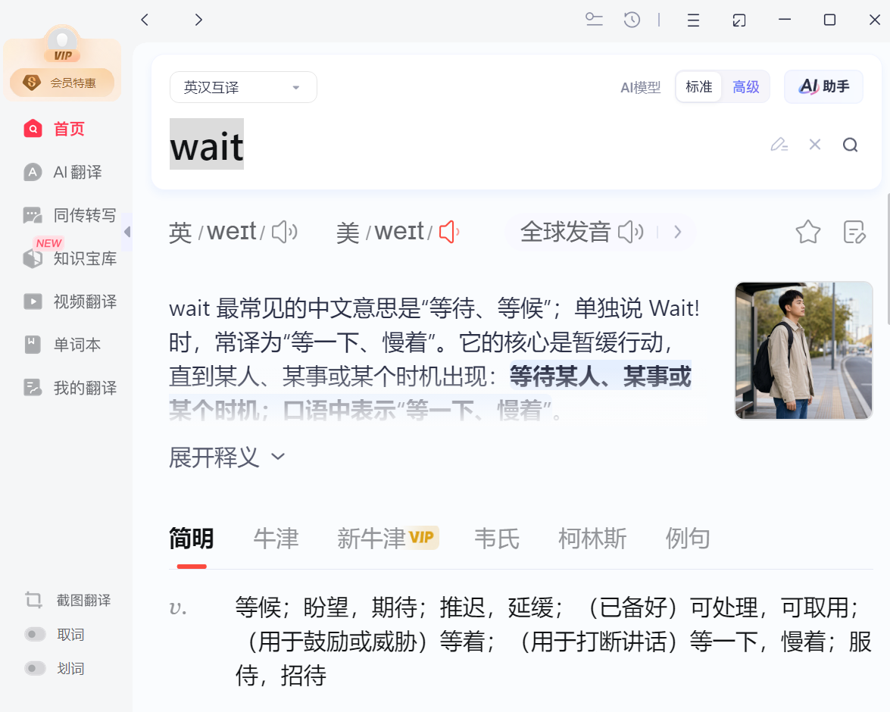
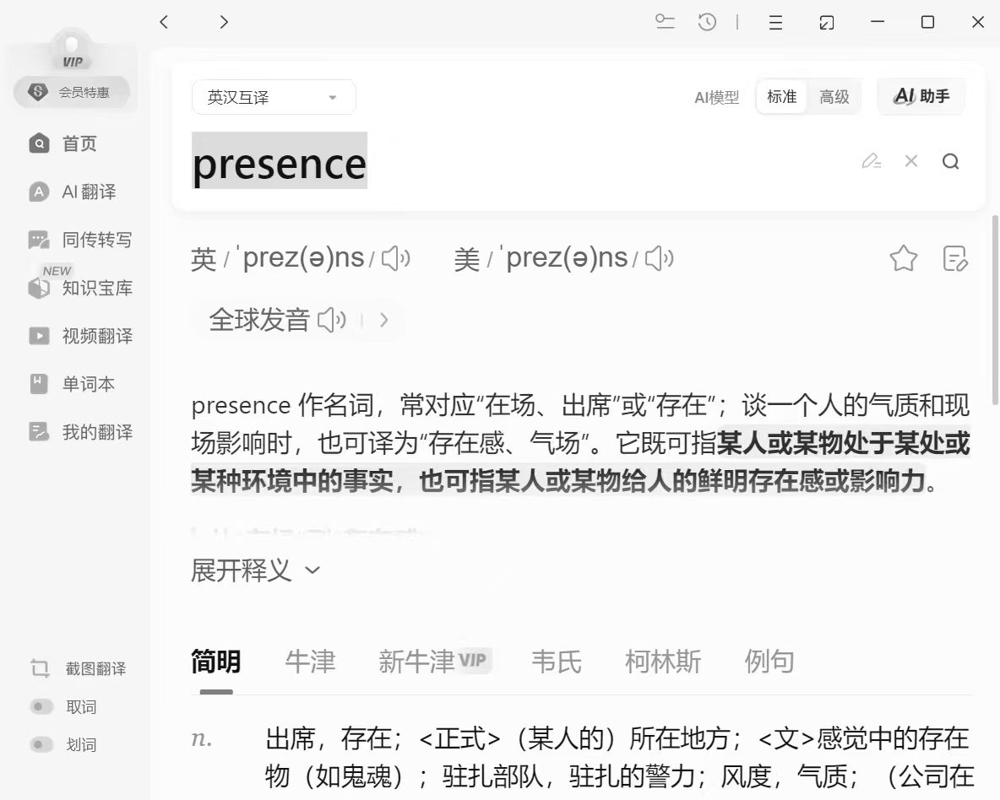
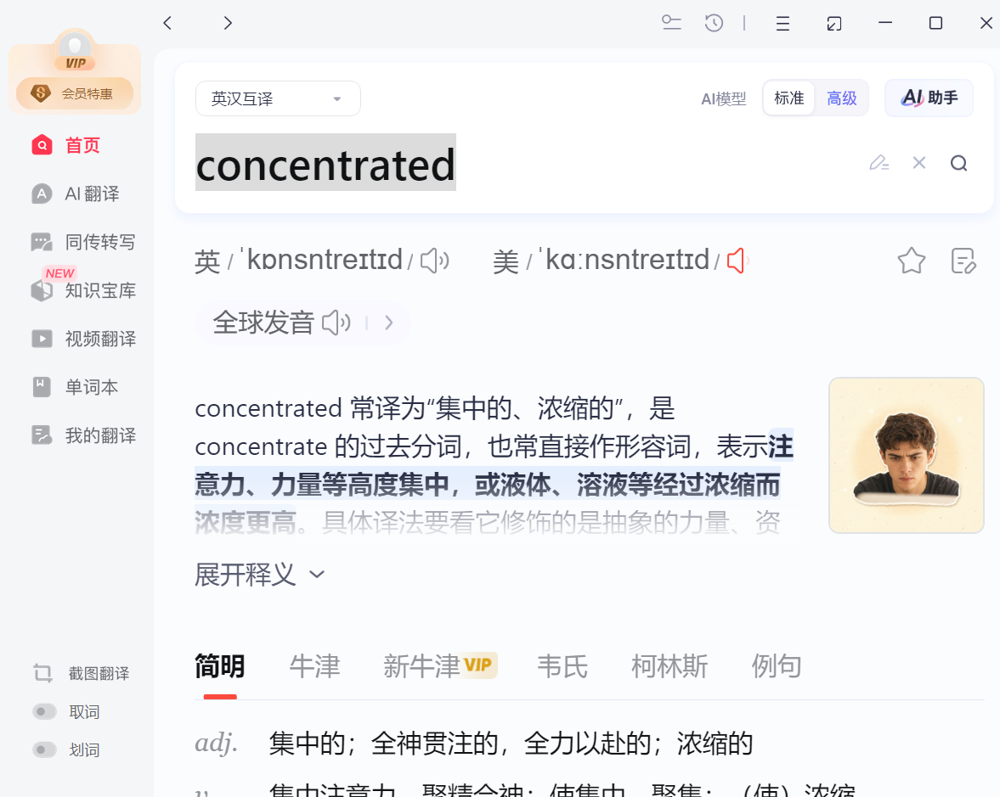
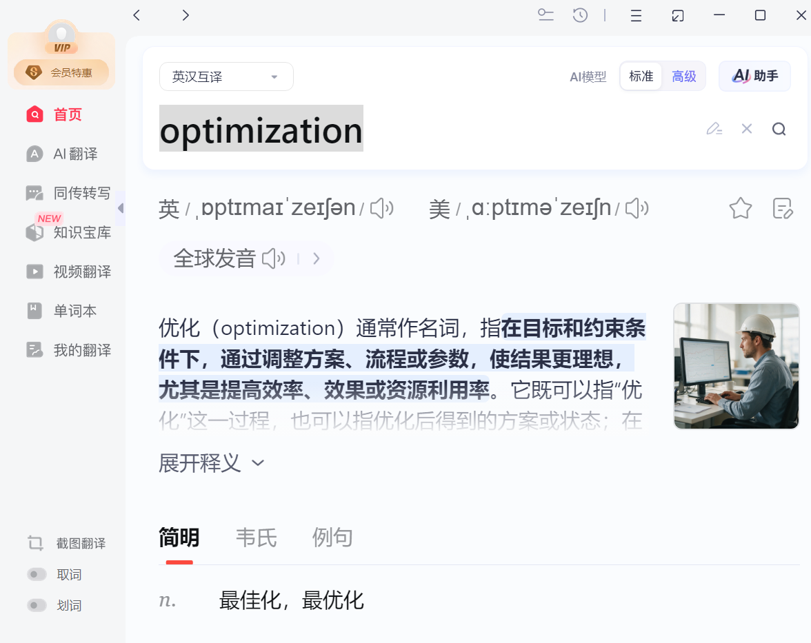
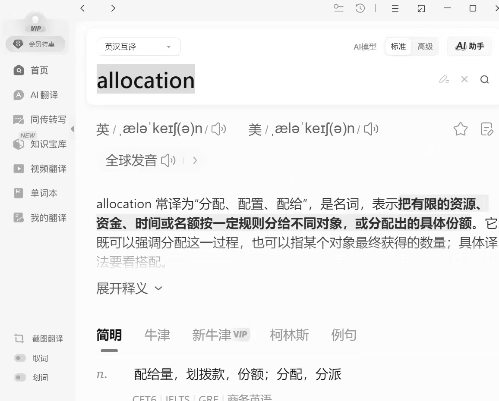
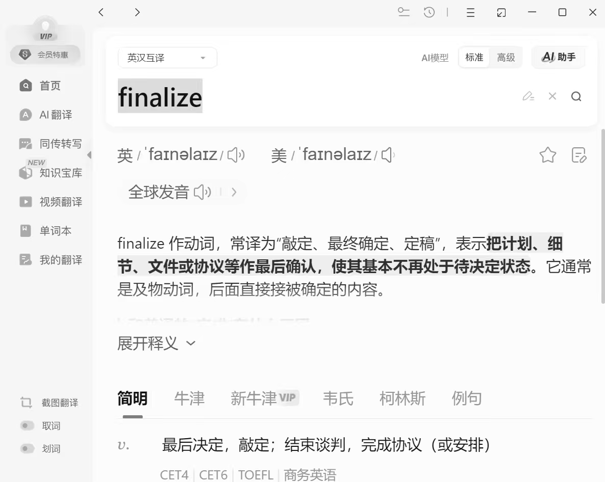
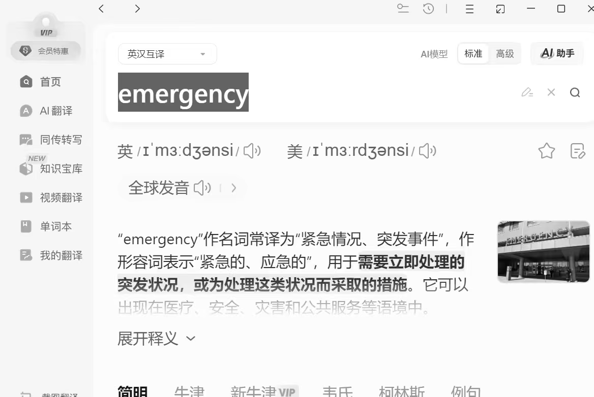
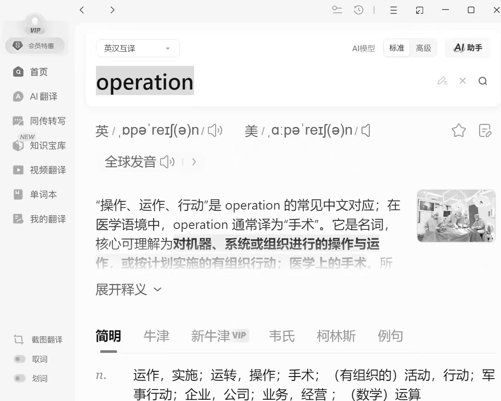
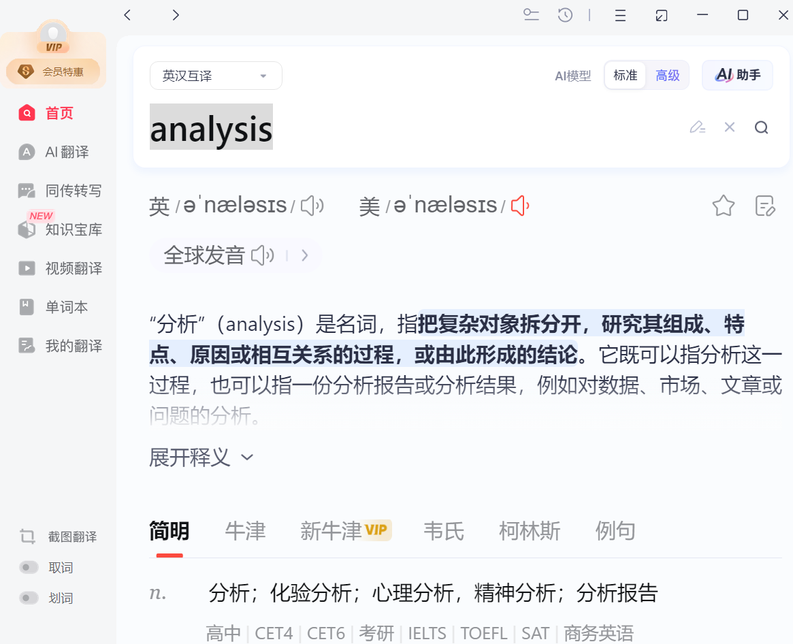
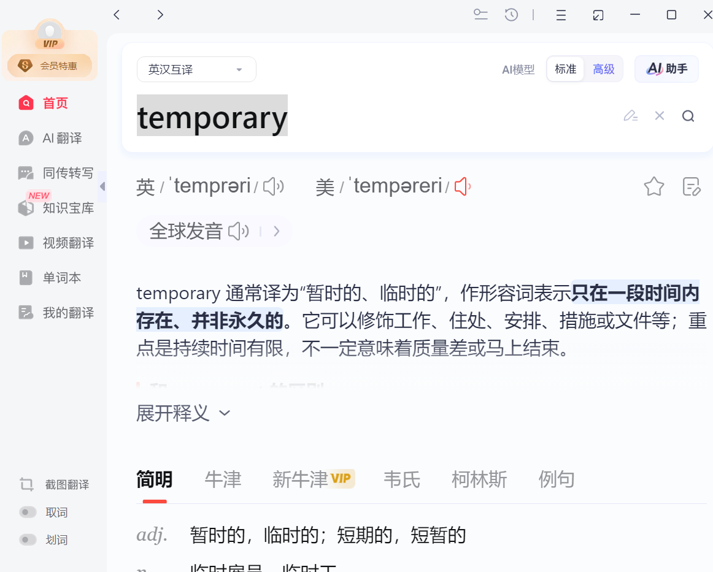

# Open a Meeting

Lesson 16: Opening a Meeting（2026-10-26，来自微信 Adam 分享的单词卡片）

## Core Vocab & Phrases（核心词汇与短语）

wait（等待）, last（上一个）, distinct（不同的，明显的）, today（今天）
presence（出席，在场）, focused（专注的）, concentrated（集中的，浓缩的）, optimization（优化）
attendee（参会人）, allocation（分配）, finalize（最终确定）, emergency（紧急情况）
operation（操作，运营）, analysis（分析）, temporary（临时的）

## Key Sentence Patterns（重点句型）

Let's open the meeting.（我们开始开会吧。）
Welcome, everyone. Thank you for your presence today.（欢迎大家，感谢各位今天出席。）
Let's finalize the agenda before we start.（开始前我们先把议程定下来。）
Is everyone here? Are all attendees present?（人都到齐了吗？）
We'll make this meeting short and focused.（这次会议我们会开得简短、专注。）
This is just a temporary solution; we'll do a deeper analysis later.（这只是临时方案，之后我们会做更深入的分析。）

## 今日单词卡片（Adam 分享）

## 课程文件

课件：Adam Business English.pptx（Lesson 16: Opening a Meeting）
